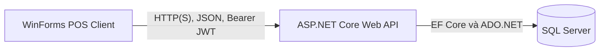
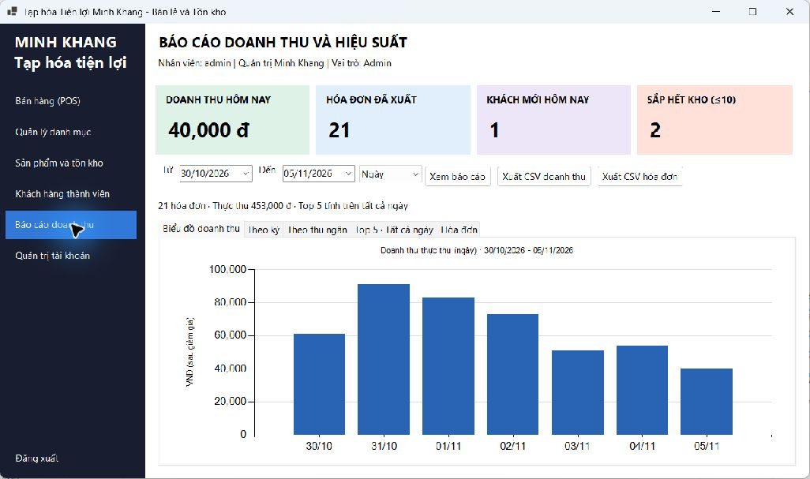

# Tạp hóa Tiện lợi Minh Khang

**Phát triển Giải pháp Phần mềm Bán lẻ và Kiểm soát Hàng tồn kho tự động**

Đồ án môn Lập trình Ứng dụng .NET Core, xây dựng hệ thống bán hàng tại quầy và quản lý tồn kho cho một cửa hàng tạp hóa. WinForms gọi Web API để đăng nhập, tra hàng, thanh toán và xem báo cáo; dữ liệu nghiệp vụ được lưu trong SQL Server.

## Chức năng

- Đăng nhập bằng JWT; phân quyền Admin, Cashier và Warehouse ở cả giao diện lẫn API.
- Shell gồm menu bên trái, tiêu đề bên trên và form nghiệp vụ nhúng ở giữa.
- Quản lý nhóm hàng, sản phẩm, mã vạch, giá bán và tồn kho; tìm kiếm, lọc theo nhóm và phân trang trên máy chủ.
- Quản lý khách hàng, địa chỉ đủ bốn phần, hạng thành viên và điểm thưởng.
- POS nhận mã vạch bằng Enter, cộng dồn số lượng, tính tiền hàng, giảm giá và tiền thối.
- Thanh toán và hủy hóa đơn trong transaction: hóa đơn, chi tiết, kho và điểm được cập nhật cùng nhau; lỗi thì rollback.
- Đổi điểm theo quy tắc **1 điểm = 1.000đ**; cộng điểm mới bằng phần nguyên **tiền thực trả / 10.000**.
- Tô màu `LightCoral` các dòng có tồn kho **≤ 10**, hiển thị số mặt hàng sắp hết trên toàn kho.
- Dashboard gồm doanh thu hôm nay, tổng hóa đơn hoàn tất đã xuất, khách mới hôm nay và số mặt hàng sắp hết.
- Biểu đồ cột doanh thu theo ngày, tuần hoặc tháng; bảng doanh thu thu ngân và danh sách hóa đơn.
- Top 5 sản phẩm bán chạy theo số lượng để hỗ trợ nhập hàng.
- Xuất toàn bộ danh mục tồn kho, doanh thu theo kỳ hoặc hóa đơn trong khoảng chọn ra **CSV UTF-8**, mở được bằng Excel.
- Thông báo tiếng Việt kèm mã HTTP, ví dụ `404 - Không tìm thấy mã vạch sản phẩm` hoặc `409 - ...không đủ tồn kho...`.

## Kiến trúc và công nghệ



| Thành phần | Công nghệ |
| --- | --- |
| Nền tảng | C#, .NET 8 |
| Backend | ASP.NET Core Web API, Dependency Injection, async/await |
| Dữ liệu | SQL Server, EF Core Code First, Migrations, LINQ |
| ADO.NET | SqlConnection, SqlCommand, SqlDataReader, SqlDataAdapter, SqlTransaction |
| Bảo mật | JWT Bearer, Role-Based Access Control, PasswordHasher cho mật khẩu mới/đặt lại |
| Giao diện | Windows Forms, DataGridView, HttpClient dùng chung, Chart dạng Column |
| Tài liệu API | Swagger UI / OpenAPI |
| Kiểm thử | xUnit, WebApplicationFactory, SQLite tạm, T-SQL ScriptDom |

Solution chính giữ **đúng hai project**: API và WinForms. `MiniSupermarket.Tests` là project kiểm thử riêng, nằm ngoài solution chính.

```text
MiniSupermarket.API/
├── MiniSupermarket.API.sln        # Solution API + WinForms
├── Controllers/                  # Auth, Categories, Products, Customers, Orders, Reports, Users
├── Models/                       # 6 entity và các request/response DTO
├── Data/                         # SupermarketDbContext, AdoDatabase
├── Services/                     # CheckoutService, RevenueReportService
├── Security/                     # Xử lý mật khẩu
├── Migrations/                   # Lịch sử thay đổi cấu trúc CSDL
├── Database/                     # SQL khởi tạo và các script nâng cấp
└── appsettings*.json             # Kết nối SQL, JWT, CORS
MiniSupermarket.WinForms/
├── FormMainShell.cs              # Điều phối menu và vùng làm việc
├── FormPOS.cs                    # Quầy bán hàng và đổi điểm
├── FormQuickReport.cs            # Dashboard, biểu đồ và báo cáo
├── Form*Management.cs            # Các màn hình quản lý
├── SessionManager.cs             # SessionManager và ApiClientService
├── CsvExport.cs                  # Xuất CSV
└── api-settings.json             # Địa chỉ Web API
MiniSupermarket.Tests/            # Kiểm thử chức năng, phân quyền, giao dịch, SQL và giao diện
MinhChungKiemThu/                  # Ảnh và dữ liệu kiểm thử
.vscode/                         # Cấu hình chạy bằng SDK dotnet trên PATH
```

## Chuẩn bị môi trường

- Windows, vì client sử dụng WinForms.
- .NET 8 SDK.
- Visual Studio 2022 với workload **ASP.NET and web development** và **.NET desktop development**, hoặc VS Code với extension C#.
- SQL Server Express/Developer hoặc SQL Server LocalDB; có thể dùng SSMS để xem dữ liệu.

Tải mã nguồn:

```powershell
git clone https://github.com/stx103/MiniSupermarket.API.git
cd MiniSupermarket.API
dotnet --version
dotnet tool restore
dotnet restore MiniSupermarket.API/MiniSupermarket.API.sln
```

### Cấu hình kết nối

Backend đọc `ConnectionStrings:DefaultConnection` trong `MiniSupermarket.API/appsettings.json`. Môi trường `Development` ghi đè bằng `MiniSupermarket.API/appsettings.Development.json`, hiện dùng:

```json
{
  "ConnectionStrings": {
    "DefaultConnection": "Server=(localdb)\\MSSQLLocalDB;Database=MinhKhangMiniSupermarketDb;Trusted_Connection=True;TrustServerCertificate=True;MultipleActiveResultSets=true"
  }
}
```

Nếu dùng SQL Server Express, thay `Server` bằng instance thực tế, chẳng hạn `.\SQLEXPRESS`. Chuỗi kết nối được cấu hình tập trung trong JSON; WinForms chỉ chứa URL API, không kết nối trực tiếp SQL Server.

`MiniSupermarket.WinForms/api-settings.json`:

```json
{
  "ApiBaseUrl": "https://localhost:7163/api/"
}
```

Khi đổi máy hoặc cổng chạy, cập nhật hai nơi cấu hình tương ứng. Tài khoản seed và khóa JWT hiện tại phục vụ học tập; dùng thông tin xác thực và khóa riêng nếu triển khai ngoài môi trường demo.

## Tạo hoặc nâng cấp cơ sở dữ liệu

### Cách 1 — EF Core Migrations

Dùng khi tạo database mới, hoặc cập nhật database đã có lịch sử EF:

```powershell
$env:ASPNETCORE_ENVIRONMENT = "Development"
dotnet ef database update --project MiniSupermarket.API --startup-project MiniSupermarket.API
```

Trong Package Manager Console của Visual Studio có thể dùng:

```powershell
Update-Database -Project MiniSupermarket.API -StartupProject MiniSupermarket.API
```

Bài đã có bốn migration:

| Migration | Nội dung |
| --- | --- |
| `InitialCreate` | Sáu bảng, quan hệ, chỉ mục, CHECK giá/tồn và 20 dòng seed mỗi bảng |
| `AddRevenueProcedures` | Các stored procedure báo cáo ban đầu |
| `StandardizeCustomerAddresses` | Chuẩn hóa và kiểm tra địa chỉ khách hàng |
| `DashboardLoyalty` | Ngày đăng ký khách, điểm đổi, tiền giảm, tiền thực thu và báo cáo ngày |

EF chỉ áp dụng migration còn thiếu. **Không cần drop database** khi nâng cấp và không tạo lại `InitialCreate` để chạy bài.

### Cách 2 — SQL thủ công

Các tệp nằm trong [MiniSupermarket.API/Database](MiniSupermarket.API/Database):

- `MinhKhangMiniSupermarketDb.sql`: khởi tạo đầy đủ sáu bảng, mỗi bảng 20 dòng và bốn stored procedure. **Script này xóa các bảng cũ khi chạy lại**, chỉ dùng để chuẩn bị database demo có thể đặt lại.
- `Upgrade_Buoi4.sql`, `Upgrade_Buoi5_6.sql`, `Upgrade_25Criteria.sql`, `Upgrade_CustomerAddresses.sql`: nâng cấp các phiên bản thực hành trước theo thứ tự phù hợp.
- `Upgrade_Dashboard_Loyalty.sql`: bổ sung dashboard/đổi điểm/báo cáo ngày cho database SQL thủ công đã có cấu trúc buổi 5–6 và địa chỉ chuẩn; chọn đúng database trước khi Execute.

Không chạy migration khởi tạo lên database đã có bảng do SQL thủ công tạo nhưng chưa có lịch sử EF. Chọn một cách quản lý phù hợp với database hiện có và sao lưu trước khi thực hiện thay đổi cấu trúc.

### Mô hình dữ liệu

| Bảng | Vai trò |
| --- | --- |
| `Users` | Nhân viên, vai trò và trạng thái tài khoản |
| `Categories` | Nhóm hàng |
| `Products` | Mã vạch, tên, giá bán, tồn kho và nhóm hàng |
| `Customers` | Hồ sơ thành viên, ngày đăng ký và điểm hiện tại |
| `Orders` | Hóa đơn, người bán, tiền hàng, giảm giá, thực thu và điểm |
| `OrderDetails` | Sản phẩm, số lượng và đơn giá tại thời điểm bán |

Địa chỉ khách hàng có dạng **`Số nhà, Tên đường, Phường/Xã, Tỉnh/Thành phố`**, ví dụ `12, Đường Nguyễn Huệ, Phường Sài Gòn, Thành phố Hồ Chí Minh`. Dữ liệu seed là dữ liệu mô phỏng để học và kiểm thử.

## Chạy ứng dụng

### Visual Studio 2022

1. Mở `MiniSupermarket.API/MiniSupermarket.API.sln`.
2. Chuẩn bị database và kiểm tra cấu hình kết nối.
3. Cấu hình Multiple Startup Projects cho API và WinForms, hoặc chạy API trước rồi chạy WinForms.
4. Chọn profile API `https`; đăng nhập bằng một tài khoản demo bên dưới.

### Terminal hoặc VS Code

Chuẩn bị chứng chỉ HTTPS cho môi trường phát triển nếu máy chưa có:

```powershell
dotnet dev-certs https --trust
```

Terminal thứ nhất:

```powershell
dotnet run --project MiniSupermarket.API --launch-profile https
```

Terminal thứ hai:

```powershell
dotnet run --project MiniSupermarket.WinForms
```

Swagger: **https://localhost:7163/swagger**. API có thêm địa chỉ HTTP phát triển `http://localhost:5167` theo launch profile.

Trong VS Code, mở thư mục gốc repository rồi chọn cấu hình **Minh Khang: API + WinForms** ở Run and Debug. Các task sử dụng lệnh `dotnet` trên PATH của máy, không phụ thuộc thư mục SDK riêng của người phát triển.

Nếu build báo `MSB3021/MSB3027` hoặc không chép được `.exe/.dll`, dừng phiên chạy bằng **Shift+F5** và đóng bản ứng dụng cũ trước khi build lại.

## Tài khoản và quyền

Mật khẩu mẫu của các tài khoản dưới đây là **`123456`**, nếu chưa được thay đổi trong database đang dùng.

| Tài khoản | Vai trò | Chức năng |
| --- | --- | --- |
| `admin` / `admin01` | Admin | Quản lý dữ liệu, POS, tài khoản, dashboard và báo cáo tài chính |
| `cashier` / `cashier01` | Cashier | Chỉ thấy POS; tra barcode/thành viên; thanh toán, đổi điểm và xem/hủy hóa đơn của mình |
| `warehouse01` / `ware01` | Warehouse | Nhóm hàng, sản phẩm, tồn kho, xuất CSV kho và Top 5 theo số lượng |

Cashier không được sửa giá, sửa tồn kho, quản lý khách hàng/danh mục/tài khoản hoặc xem doanh thu. Warehouse không được xem báo cáo tài chính; API Top 5 cho Warehouse chỉ trả mã, tên và số lượng bán. API kiểm tra JWT và role độc lập với việc ẩn nút trên giao diện.

## Thanh toán và đổi điểm

1. Vào POS, nhập/quét barcode và nhấn Enter. Quét lại cùng mã sẽ cộng số lượng vào dòng đang có.
2. Nhập số điện thoại thành viên và chọn **Tìm khách hàng**, hoặc để trống cho khách vãng lai.
3. Chọn số điểm muốn đổi. Một điểm giảm 1.000đ; không vượt số dư điểm hoặc giá trị tiền hàng.
4. Nhập tiền khách đưa, kiểm tra tiền thối rồi chọn Thanh toán hoặc nhấn F9.

Ví dụ: mua 5 sản phẩm giá 12.000đ, dùng 50 điểm thì tiền hàng 60.000đ, giảm 50.000đ, còn trả 10.000đ. Đưa 20.000đ thì nhận lại 10.000đ và được cộng 1 điểm mới.

`CheckoutService` đọc lại giá từ database, lưu hóa đơn/chi tiết, trừ kho và cập nhật điểm trong cùng `SqlTransaction`. Thiếu kho, thiếu điểm hoặc lỗi ở bước sau sẽ hoàn tác toàn bộ giao dịch. Khi hủy hợp lệ, hệ thống hoàn kho, hoàn điểm đã đổi và thu hồi điểm đã tặng; không hoàn dữ liệu thêm khi gọi hủy lần hai.

## Dashboard và biểu đồ doanh thu

- Mở **Báo cáo doanh thu**: giao diện tự chọn **tháng có hóa đơn gần nhất** để hiển thị biểu đồ.
- Chọn **Từ/Đến**, chọn **Ngày/Tuần/Tháng**, rồi bấm **Xem báo cáo** để lọc theo khoảng riêng.
- Nút **Tháng có hóa đơn** đưa bộ lọc về tháng gần nhất có dữ liệu.
- Khoảng không có hóa đơn hiển thị thông báo rõ ràng trên biểu đồ. Các ngày không bán có doanh thu bằng 0.
- Bốn KPI có phạm vi riêng: doanh thu và khách mới tính hôm nay; hóa đơn tính toàn bộ hóa đơn hoàn tất còn lưu; hàng sắp hết tính toàn kho.
- Top 5 xếp theo số lượng bán của tất cả ngày. Doanh số sản phẩm dành cho Admin là doanh số trước ưu đãi; các báo cáo doanh thu dùng **tiền thực thu sau giảm giá**.

Dữ liệu seed EF có ngày cố định **08/10/2026**. Vì vậy ô doanh thu hôm nay có thể bằng 0 khi chưa bán hàng trong ngày, dù tháng chứa dữ liệu mẫu vẫn có cột doanh thu. Khi kiểm thử bộ dữ liệu khác, chọn khoảng ngày phù hợp thay vì sửa ngày các hóa đơn đã bán.



Ảnh trên sử dụng database kiểm thử riêng. Các ảnh POS, tồn kho và hóa đơn cùng số liệu đối soát nằm trong [thư mục minh chứng](MinhChungKiemThu/2026-11-05/README.md).

## Một số API chính

Đăng nhập ở `/api/auth/login`, lấy token rồi bấm **Authorize** trên Swagger để gọi API bảo mật.

| HTTP | Endpoint | Chức năng |
| --- | --- | --- |
| POST | `/api/auth/login` | Đăng nhập, nhận JWT |
| GET/POST | `/api/categories` | Lấy danh sách hoặc tạo nhóm hàng |
| PUT/DELETE | `/api/categories/{id}` | Sửa hoặc xóa nhóm hàng |
| GET/POST | `/api/products` | Lấy danh sách đầy đủ hoặc thêm sản phẩm |
| PUT/DELETE | `/api/products/{id}` | Sửa hoặc xóa sản phẩm |
| GET | `/api/products/paged` | Tìm kiếm, lọc nhóm và phân trang |
| GET | `/api/ado-products/barcode/{barcode}` | Tra mã vạch bằng ADO.NET |
| GET | `/api/ado-products/filter-stock?minStock=10` | Mặt hàng tồn không quá ngưỡng |
| GET/POST | `/api/customers` | Danh sách hoặc thêm khách hàng |
| PUT/DELETE | `/api/customers/{id}` | Sửa hoặc xóa khách hàng |
| GET | `/api/customers/phone/{phone}` | Tra thành viên tại POS |
| POST | `/api/checkout` | Thanh toán, trừ kho và đổi/cộng điểm |
| GET | `/api/orders/{id}` | Xem hóa đơn theo quyền |
| DELETE | `/api/checkout/cancel/{orderId}` | Hủy hóa đơn theo quyền |
| GET | `/api/reports/dashboard-summary` | Bốn KPI và ngày hóa đơn gần nhất |
| GET | `/api/reports/daily-revenue` | Doanh thu theo kỳ ngày/tuần/tháng |
| GET | `/api/reports/revenue-by-date-range` | Tổng hợp theo thu ngân trong khoảng ngày |
| GET | `/api/reports/orders` | Hóa đơn dùng cho bảng báo cáo và xuất CSV |
| GET | `/api/reports/top-selling` | Top 5 bán chạy, giới hạn dữ liệu theo role |
| GET/POST | `/api/users` | Danh sách hoặc tạo tài khoản, chỉ Admin |

Ví dụ query báo cáo:

```text
/api/reports/daily-revenue?fromDate=2026-10-01&toDate=2026-10-31&period=day
/api/products/paged?pageNumber=1&pageSize=5&keyword=&categoryId=3
```

Ví dụ body thanh toán:

```json
{
  "customerId": 1,
  "pointsToRedeem": 50,
  "cashReceived": 20000,
  "expectedTotalAmount": 60000,
  "items": [
    { "productId": 1, "quantity": 5 }
  ]
}
```

Máy chủ xác định người bán từ JWT và tính lại giá; số điểm và tồn kho cần đủ tại thời điểm thanh toán. Phản hồi dùng các mã `200`, `201`, `204`, `400`, `401`, `403`, `404`, `409` theo nghiệp vụ. Danh mục endpoint và cấu trúc DTO đầy đủ có trong Swagger.

## Kiểm thử

```powershell
dotnet build MiniSupermarket.API/MiniSupermarket.API.sln -c Release
dotnet test MiniSupermarket.Tests/MiniSupermarket.Tests.csproj -c Release
```

Bản cập nhật biểu đồ đã kiểm tra **149 trường hợp đạt, 0 thất bại, 0 bỏ qua**. Bộ test bao phủ xác thực/phân quyền, DTO/CRUD, địa chỉ khách, phân trang, ADO.NET, thanh toán/hủy/rollback, đổi điểm, KPI, kỳ doanh thu, chuẩn CSV, cấu trúc migration và giao diện.

Các test tích hợp dùng SQLite tạm và không yêu cầu kết nối SQL Server thật; cú pháp T-SQL/migration được kiểm tra riêng. Chúng không thay thế kiểm thử stored procedure, khóa đồng thời và khả năng chịu tải trên SQL Server. Hồ sơ tại `MinhChungKiemThu` ghi lại các ca SQL Server thực tế đã chạy; các ca này sử dụng database kiểm thử riêng.

## Báo cáo và minh chứng

- [Báo cáo đồ án Word](LTUD_TrinhQuangThuan_2124110106_CCQ2411D.docx).
- [Hướng dẫn tìm và kiểm thử 25 tiêu chí](Huong_dan_tim_va_test_25_tieu_chi_Minh_Khang.docx).
- [Ảnh và dữ liệu kiểm thử](MinhChungKiemThu/2026-11-05/).

Trong mã nguồn có ghi chú tiêu chí **11 đến 35** để tra cứu khi trình bày. Báo cáo có ảnh màn hình tại mục **5.4.3** và bảng đối chiếu các tiêu chí giao diện/chức năng mở rộng tại **phụ lục G**.

Phạm vi hiện tại là một cửa hàng: chưa có quản lý lô/hạn sử dụng, nhiều chi nhánh, thanh toán ngân hàng, nhật ký hủy bất biến hoặc chống gửi trùng bằng idempotency. Xuất báo cáo hiện là CSV, chưa phải tệp XLSX được định dạng sẵn.

## Thông tin sinh viên

- **Họ tên:** Trịnh Quang Thuận
- **MSSV:** 2124110106
- **Lớp:** CCQ2411D
